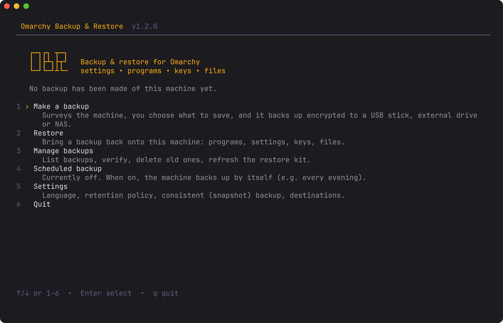
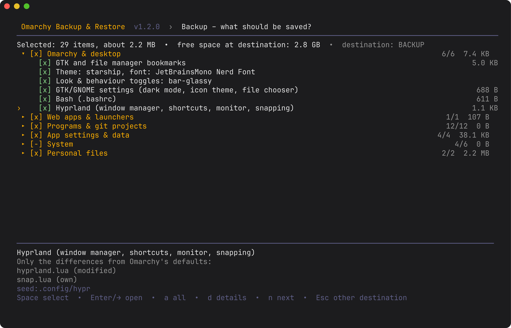

# Omarchy Backup & Restore (`obr`)

[English README → README.md](README.md)

Mentő- és visszaállító program Omarchy-hoz. Titkosítva menti a beállításaidat, a
programlistádat, a kulcsaidat és a fájljaidat pendrive-ra, külső lemezre vagy a
Synology NAS-ra. Egy friss Omarchy-n ugyanonnan mindent visszarak.

<p align="center">
  
  
</p>

> A program alapból **angol** nyelvű. Az első indításkor megkérdezi a nyelvet: válaszd a **Magyar**-t.
> Később a **Settings / Beállítások** menüben bármikor átállítható.

- [0. rész – A program feltelepítése egy gépre](#0-rész--a-program-feltelepítése-egy-gépre)
- [1. rész – Mentés készítése](#1-rész--mentés-készítése)
- [2. rész – Visszaállítás egy új (friss) Omarchy-ra](#2-rész--visszaállítás-egy-új-friss-omarchy-ra)
- [3. rész – Mentés a Synology NAS-ra](#3-rész--mentés-a-synology-nas-ra)
- [4. rész – Ütemezett (automatikus) mentés](#4-rész--ütemezett-automatikus-mentés)
- [Billentyűk](#billentyűk)
- [Ha valami nem stimmel](#ha-valami-nem-stimmel)

---

## 0. rész – A program feltelepítése egy gépre

**Honnan van meg a program?** Minden mentésnél a program saját magát is odamásolja a
mentés mellé, a lemezen az `omarchy-backup/kit/` mappába. Tehát ahol a mentésed van,
ott a program is megvan. Internetről nem kell letölteni.

| Helyzet | Mit csinálj |
|---|---|
| **Ez a mostani gép** | Semmit, a program már telepítve van. |
| **Új vagy újratelepített gép, és vissza akarod állítani a régi mentést** | Ugorj a [2. részre](#2-rész--visszaállítás-egy-új-friss-omarchy-ra). Ott egy parancs telepíti a programot, és rögtön el is indítja a visszaállítást. |
| **Új gép, és csak a programot akarod feltenni** (például hogy mentést készíts róla) | Kövesd a lenti lépéseket: GitHubról vagy a mentéses lemezről. |

### Telepítés GitHubról (forrásból)

Ha még nincs mentésed, vagy egyszerűen a legfrissebb változatot szeretnéd:

```bash
git clone https://github.com/gaborkis11/omarchy-backup-restore.git ~/Applications/omarchy-backup-restore
cd ~/Applications/omarchy-backup-restore
./install.sh
```

Az `install.sh` mindent megcsinál:
- ha kell, a `mise`-zal feltelepíti a Go-t;
- lefordítja a restic-et és az rclone-t (az első alkalommal ez pár percig tart);
- feltelepíti a programot, beteszi az alkalmazásmenübe, és az ikonját a dockba.

Rendszergazdai jelszó nem kell hozzá.

### Telepítés visszaállítás nélkül (a mentéses lemezről)

1. Dugd be azt a lemezt, amelyen a mentésed van.
2. Nyomd meg a **`Super + Enter`**-t (terminál), másold be ezt a sort, és nyomj Entert:

   ```bash
   bash /run/media/$USER/*/omarchy-backup/kit/install.sh
   ```

3. Kész. A program innentől úgy indítható, mint bármelyik másik app:
   - **a dockban** a narancssárga körkörös nyíl ikonra kattintva (a telepítő magától odateszi), vagy
   - **`Super + Space`**, majd írd be: **Omarchy Backup**, és Enter, vagy
   - terminálban: `obr`.

Ezt a parancsot csak egyszer kell beírni egy gépen, utána mindig az ikonnal indítod.

---

## 1. rész – Mentés készítése

Ha a gépen még nincs fent a program, előbb csináld meg a [0. részt](#0-rész--a-program-feltelepítése-egy-gépre).

### Lépések

1. **Dugd be a mentéshez használt lemezt** (például a `BACKUP` külső lemezt). Az Omarchy magától csatolja.

2. **Kattints a dockban az Omarchy Backup & Restore ikonra.** Megnyílik a főmenü.

3. **Válaszd az `1` Mentés készítése pontot** (`1`, vagy Enter).

4. **Hova mentsen?** Válaszd ki a lemezt, például `Lemez: BACKUP`, és nyomj Entert.
   A program megjegyzi; legközelebb, ha ugyanez a lemez van bedugva, ezt a lépést kihagyja.

5. **Várj pár másodpercet**, amíg felméri a gépet.

6. **Mit mentsünk?** Megjelennek a kategóriák, pipákkal.
   - Az alapbeállítás jó, **nem kell semmit változtatnod**. Minden be van pipálva, kivéve a nagy AI-modelleket.
   - Ha bele akarsz nézni: `Enter` kinyit egy kategóriát, alul látod, mi van benne. `Space` ki- vagy bepipál.
   - Ami új az előző mentés óta, mellette **ÚJ** áll.
   - Felül látod, mennyi adat lesz, és mennyi hely van a lemezen.
   - **Ha kész vagy, nyomd meg az `n` gombot** (tovább).

7. **Futó programok:** ha egy olyan program fut, amelynek az adatait mented (például a Chrome), a program szól. Válaszd valamelyiket:
   - zárd be a programot, és nyomd meg: **Bezártam őket, ellenőrizd újra**;
   - vagy **Konzisztens mentés pillanatképből** (futó programok mellett is ép lesz, a gép jelszavát kéri);
   - vagy **Folytatás így is**.

8. **A gép jelszava (sudo):** ha rendszerszintű dolgot is mentesz (wifi, Bluetooth), a terminál
   kéri a **saját bejelentkezési jelszavadat**. Írd be, és nyomj Entert. Gépelés közben nem
   látszik semmi, ez így normális.
   Ha nem akarod megadni, nyomj `Ctrl + C`-t: akkor csak ezek a rendszerszintű tételek maradnak ki.

9. **A mentés jelszava:**
   - **Első alkalommal** kitalálsz egy új jelszót (legalább 8 karakter), és kétszer beírod.
     A *Helyreállító kulcs* sor maradjon `[x] igen`. Nyomj Entert.
   - Megjelenik a **helyreállító kulcsod** (például `K7M2P-QX4RT-…`). **Írd fel papírra, vagy fotózd le, és tedd el.**
     Ha a jelszót elfelejted, ezzel is meg tudod nyitni a mentést. Ez többé nem jelenik meg. Nyomj Entert.
   - **Későbbi mentéseknél** csak a jelszót kell beírnod egyszer.

10. **Mentés:** folyamatjelzőt és hátralévő időt látsz. **Közben ne húzd ki a lemezt.**
    Az első mentés tovább tart, a későbbiek csak a változásokat írják, ezért gyorsabbak.

11. **Kész.** Az összegzés megmutatja, mennyi adat került a mentésbe. Válaszd: **Vissza a menübe** vagy **Kilépés**.
    A lemezt ezután kihúzhatod.

> A mentés jelszava nélkül (vagy helyreállító kulcs nélkül) a mentést senki nem tudja
> visszaállítani, te sem. Ez a titkosítás lényege.

---

## 2. rész – Visszaállítás egy új (friss) Omarchy-ra

Ezt akkor csinálod, amikor újratelepíted a gépet, vagy új gépre költözöl.

### A) Előkészítés

1. **Telepítsd az Omarchy-t** a szokásos módon.
   - A felhasználónév és a lemeztitkosítás lehet más, mint a régi gépen, a program ezt kezeli.
2. **Jelentkezz be, és csatlakozz az internetre** (wifi vagy kábel). A programok újratelepítéséhez kell.
3. **Dugd be a mentést tartalmazó lemezt.**

### B) A program elindítása (ezt az egyet kell beírni, csak egyszer)

4. Nyomd meg a **`Super + Enter`**-t, ez megnyit egy terminált.
5. **Másold be ezt a sort, és nyomj Entert:**

   ```bash
   bash /run/media/$USER/*/omarchy-backup/kit/restore.sh
   ```

   Ez a parancs a programot feltelepíti (dock-ikon, alkalmazásmenü), és rögtön elindítja a visszaállítást.
   A parancs a lemezen lévő `LEIRAS.txt` fájlban is benne van; azt bármilyen gépen meg tudod nyitni, és onnan kimásolhatod.

### C) Visszaállítás a programban

6. **Add meg a mentés jelszavát** (vagy a helyreállító kulcsot), és nyomj Entert.
7. **Melyik mentésből?** Megjelenik a mentések listája. A legfelső a legutóbbi. Nyomj Entert.
8. **Előkészítés:** a képernyő megmutatja, melyik gépről és mikor készült a mentés, majd néhány kapcsolót. Az alapbeállítás jó:
   - **Rendszer-pillanatkép: igen.** Ha valami félremegy, a boot menüből visszaállítható.
   - **Rendszerfrissítés: igen.** A programok a legfrissebb verzióval települnek.
   - **Omarchy frissítő lépések:** csak akkor jelenik meg, ha az új Omarchy újabb. Maradjon igen.
   - **Telepítő: <projekt>: igen.** Ha egy GitHubos projektednek van telepítője (például WhisperRocket `install.sh`), letöltés után lefuttatja.

   A kapcsolók között a `Tab` billentyűvel lépsz, a `Space` kapcsol. **Az utolsó sorban nyomj Entert.**
9. **Mit kérsz vissza?** Ugyanaz a pipás lista, mint mentéskor. Az alapbeállítás jó.
   - A **szürke** tételek ezen a gépen nem állíthatók vissza (például NVIDIA-csomag, ha nincs NVIDIA videokártya, vagy a Bluetooth-párosítás más gépen). Mellettük ott az ok.
   - A már telepített programok nincsenek bepipálva (nem kell újra feltenni őket).
   - **Nyomd meg az `n` gombot** (tovább).
10. **Indítás:** az összegző képernyőn válaszd az **Indítás** pontot.
11. **A gép jelszava (sudo):** a terminál kéri a bejelentkezési jelszavadat a programok telepítéséhez. Írd be, és nyomj Entert.
12. **Várj.** Látod a lépéseket: programok, kulcsok, beállítások, téma, webappok, fájlok.
    - Ha egy beállításfájlnál az Omarchy azóta változott, és ütközik a te változatoddal, a program
      megkérdezi, melyik maradjon. A `v` gomb megmutatja a különbséget. Ha bizonytalan vagy,
      válaszd: **A saját beállításom marad**.
    - A projektek telepítője közben megnyílik, és látod a kimenetét. A végén nyomj meg egy gombot.
13. **Kész.** Az összegzés felsorolja, mi lett visszaállítva, és alul a **Teendőid**-et:
    - **Válaszd az Újraindítás most pontot.** A kulcstartó, a csoportok és a szolgáltatások ekkor lépnek teljesen életbe.
    - Újraindítás után a **Tailscale**-be jelentkezz be újra egy terminálban:
      `sudo tailscale up --operator=$USER --accept-routes`
    - Ha más gépre állítottál vissza, a **Bluetooth-eszközöket** (pl. fülhallgató) újra párosítani kell.

Ezután minden ugyanúgy néz ki és működik, mint a régi gépen. A program ikonja is ott lesz a dockban.

### Mi honnan jön vissza?

| Mi | Honnan |
|---|---|
| Telepített programok (Chrome, Spotify, Zed, Tailscale…) | Újra letölti a legfrissebb verziót. A beállításaik a mentésből jönnek. |
| Saját GitHubos projektek (a `~/Applications`, `~/Work` stb. alatt) | Letölti a GitHubról, a saját fájljaidat (például `config.json`) a mentésből teszi mellé. |
| Kézzel letöltött programok (`~/Applications`, `~/.local/bin`) | A mentésből. |
| Webappok, téma, kapcsolók | Az Omarchy saját parancsaival hozza létre újra. |
| Beállítások (Hyprland, a szélre húzás, dock), kulcsok, fájlok | A mentésből. |

---

## 3. rész – Mentés a Synology NAS-ra

### Egyszer kell beállítani a NAS-on (DSM, böngészőben)

1. **Vezérlőpult → Fájlszolgáltatások → FTP** fül → pipáld be: **SFTP szolgáltatás engedélyezése** → Alkalmaz.
2. Legyen egy **megosztott mappa** (például `backup`), amire a felhasználódnak írási joga van.

### A programban

1. Dock-ikon → **Mentés készítése** → **Synology / NAS hozzáadása**.
2. Töltsd ki a mezőket. A `Tab` billentyűvel lépsz, a `←`/`→` választ a *Kapcsolat* sorban.

   | Mező | Mit írj be |
   |---|---|
   | Név | `Synology` |
   | NAS címe | a NAS IP-címe, pl. `192.168.1.10` (vagy a neve, pl. `NAS.local`) |
   | Kapcsolat | `SFTP` |
   | Felhasználó | a DSM-felhasználóneved |
   | Jelszó | a DSM-jelszavad |

3. Az utolsó mezőn nyomj **Entert**. A program kapcsolódik, és megjelennek a NAS megosztott mappái. **Tallózz:**
   - `Enter`: belépés egy mappába;
   - `←` vagy `Backspace`: vissza egy szinttel;
   - `n`: új mappa;
   - a kívánt mappában válaszd a **✓ Ide mentsen** sort.
4. Innen ugyanúgy megy tovább, mint az [1. részben](#1-rész--mentés-készítése) az 5. lépéstől.

**Visszaállítás NAS-ról friss gépen:** a [2. rész](#2-rész--visszaállítás-egy-új-friss-omarchy-ra) B) pontja helyett ezt a három sort írd be a terminálba (a `<NAS címe>`, `<megosztás>` és `<felhasználó>` helyére a sajátodat):

```bash
mkdir -p ~/obr-kit && cd ~/obr-kit
smbclient //<NAS címe>/<megosztás> -U <felhasználó> -c 'prompt; cd omarchy-backup/kit; mget *'
bash restore.sh
```

A programban válaszd a **Synology / NAS hozzáadása** pontot ugyanazokkal az adatokkal, és tallózz el abba a mappába, ahol a mentés van. Visszaállításnál csak olyan mappát enged kiválasztani, amelyben tényleg van mentés. Utána a C) ponttól ugyanúgy megy.

**Helyi mappák** ugyanígy tallózhatók: a célhelyek listájában válaszd a **Mappa tallózása** pontot. Visszaállításnál a ★ jellel jelölt mappákban van mentés.

---

## 4. rész – Ütemezett (automatikus) mentés

1. Dock-ikon → **`4` Ütemezett mentés** → **Bekapcsolás**.
2. Válaszd ki a célhelyet. A NAS ehhez a legkényelmesebb, mert a lemeznek mindig bedugva kellene lennie.
3. Gyakoriság: **naponta 20:00**, **hetente (vasárnap 20:00)** vagy egyéni.
4. Írd be a mentés jelszavát (és NAS esetén a NAS jelszavát).
5. Az utolsó sorban a `Space` billentyűvel fogadd el a jelszó tárolását, majd nyomj Entert.
   Az automatikus mentéshez a gépnek ismernie kell a jelszót, ezért csak a te felhasználód által olvasható fájlban tárolja.

A mentés ettől kezdve magától fut, a végén értesítést kapsz. Ha a gép ki volt kapcsolva, a következő indításkor pótolja.
Kikapcsolás: ugyanitt a **Kikapcsolás** pont.

**Régi mentések törlése:** Dock-ikon → **`5` Beállítások**, és add meg, hány napi, heti és havi mentés maradjon (például 7 / 4 / 12).
A program minden mentés után magától törli a régebbieket.

---

## Billentyűk

| Billentyű | Mit csinál |
|---|---|
| `↑` `↓` | Mozgás |
| `1`–`6` | Menüpont kiválasztása |
| `Enter` | Választás. A pipás listában kategória kinyitása |
| `Space` | Pipa be / ki |
| `n` | Tovább (a pipás listákból) |
| `a` | Egy kategória összes tétele be / ki |
| `d` | Részletek panel ki / be |
| `Tab` | Következő mező (űrlapokon) |
| `Esc` | Vissza |
| `Ctrl + C` | Kilépés |

Terminálból is indítható: `obr` (főmenü), `obr tui backup` (egyből mentés), `obr tui restore` (egyből visszaállítás).

---

## Ha valami nem stimmel

| Probléma | Megoldás |
|---|---|
| „Hibás jelszó” | Próbáld a helyreállító kulccsal. |
| „A meghajtó nincs csatlakoztatva” | Dugd be a lemezt, várj pár másodpercet, és próbáld újra. |
| „A NAS nem engedett be” | Hibás a DSM-felhasználónév vagy -jelszó, vagy nincs jogod a megosztott mappához. |
| „A NAS nem érhető el” | Be van kapcsolva a NAS? Engedélyezted az SFTP-t a DSM-ben? |
| A visszaállítás után valami nem tetszik | Terminálban: `obr undo`. A felülírt fájlok visszakerülnek. A telepített programok maradnak; ezeket a rendszer-pillanatképből tudod visszaállítani (boot menü → Snapshots). |
| Részletek kellenek | A naplók itt vannak: `~/.local/state/obr/logs/` |

---

## Fejlesztőknek

- Részletes útmutató: [docs/HASZNALAT.md](docs/HASZNALAT.md)
- Visszaállítás részletei: [docs/RESTORE-GUIDE.md](docs/RESTORE-GUIDE.md)
- Felépítés (angolul): [docs/ARCHITECTURE.md](docs/ARCHITECTURE.md)
- Próbák: [docs/spike.md](docs/spike.md)

```bash
make tools      # restic + rclone forrásból → ~/.local/share/obr/bin
make install    # obr telepítése + indítók
make test       # tesztek (egységtesztek + teljes mentés→visszaállítás próba)
```
