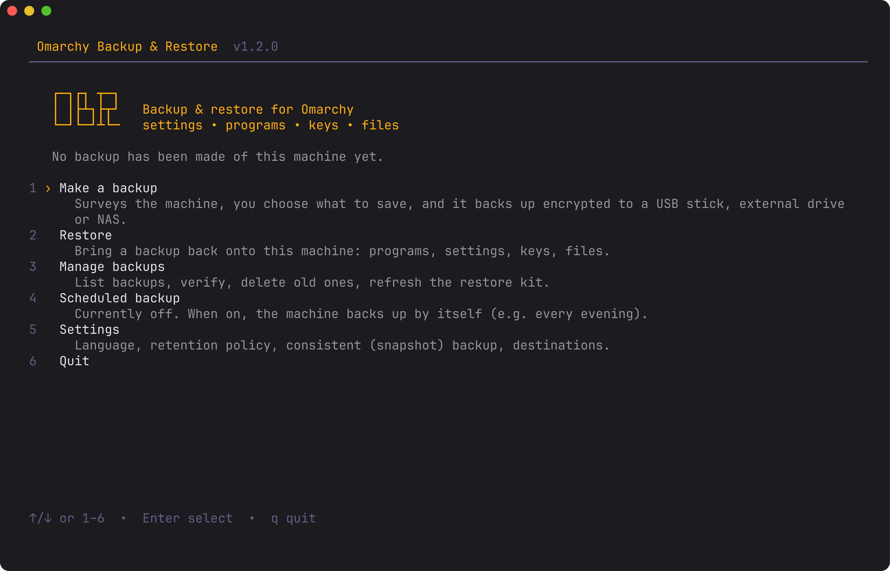
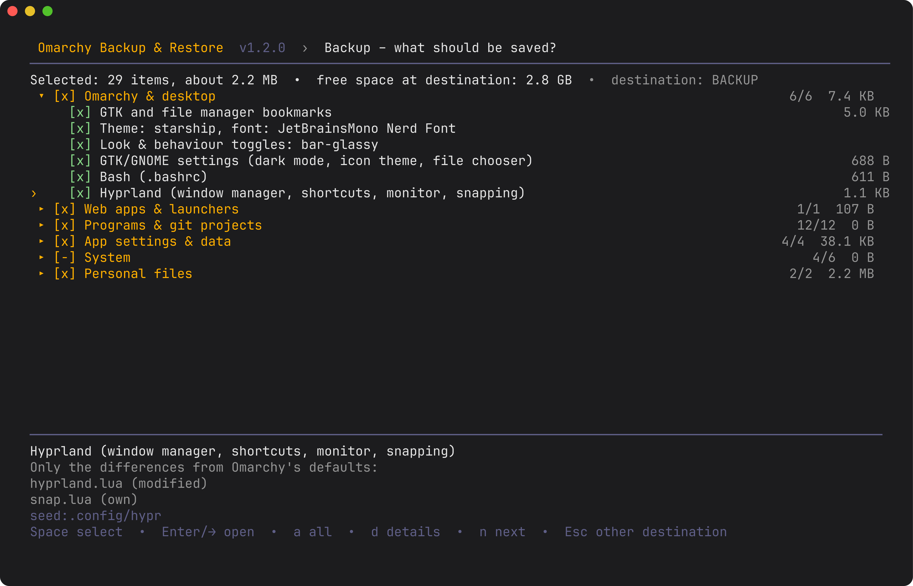
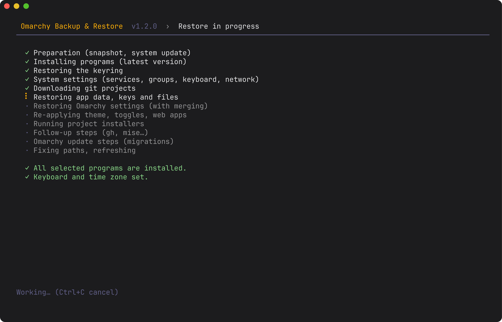
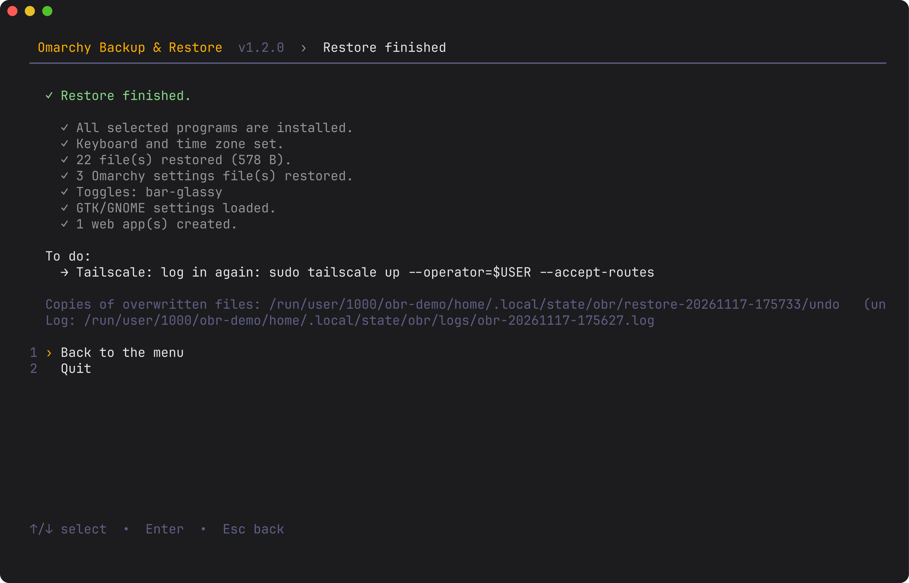
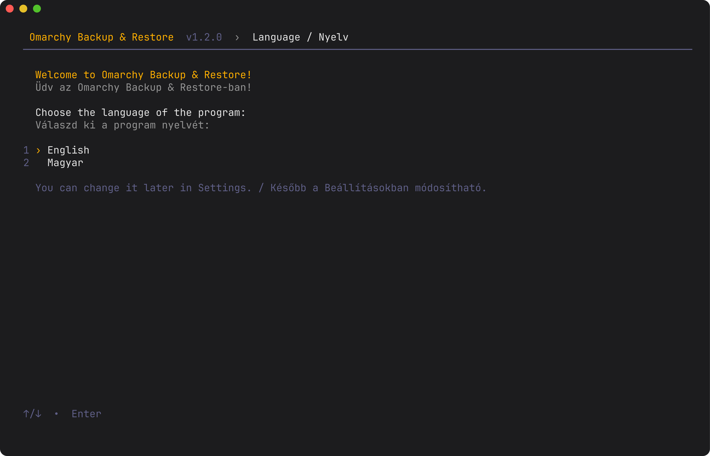
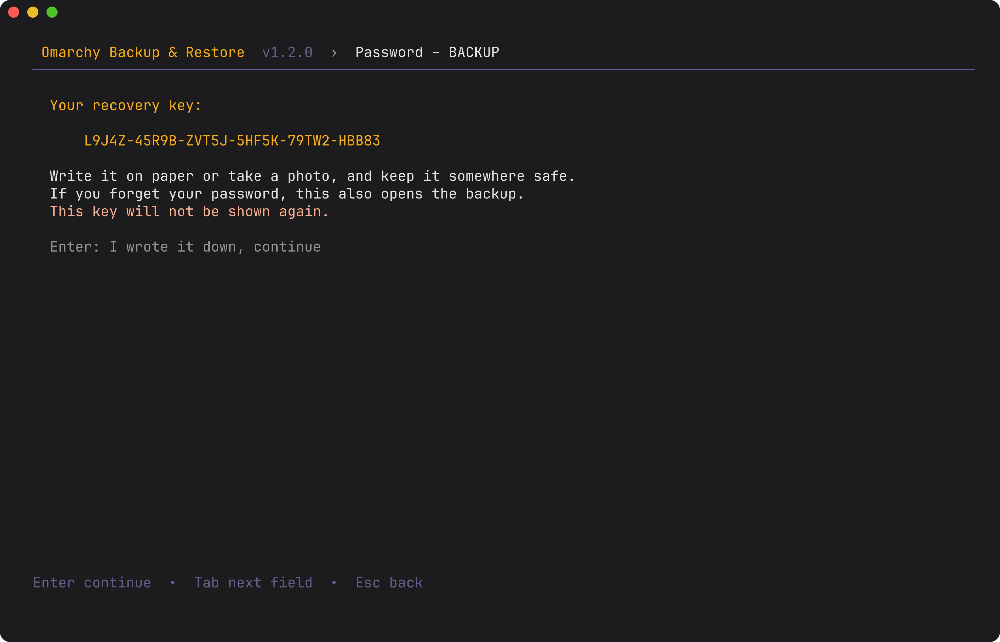
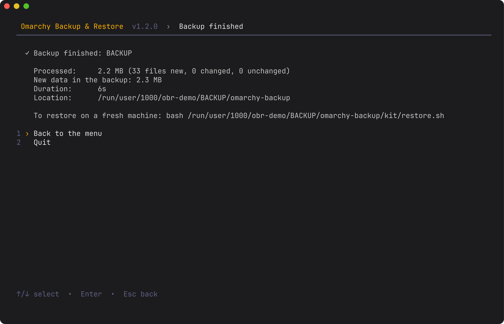
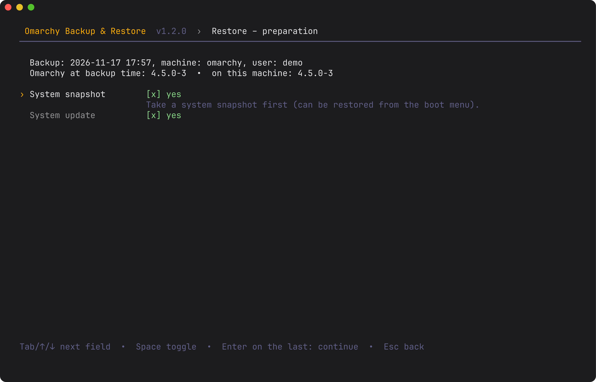
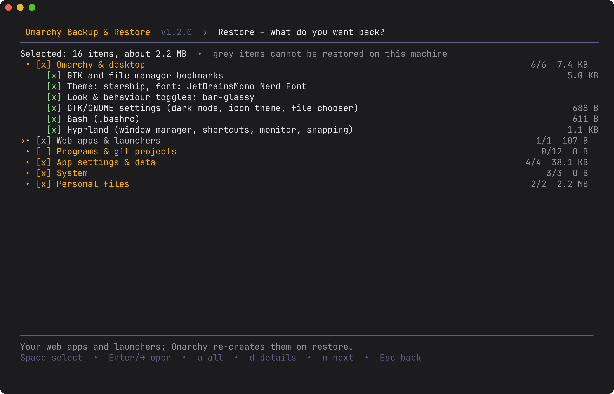

# Omarchy Backup & Restore (`obr`)

**A terminal app that backs up your [Omarchy](https://omarchy.org) machine and puts everything back on a fresh install.**

[Magyar leírás → README.hu.md](README.hu.md)

`obr` surveys your machine, lets you tick what to keep and writes an **encrypted** backup to a USB stick, an external drive or a Synology NAS. On a freshly installed Omarchy it brings everything back:

- your settings,
- your programs (reinstalled in their **latest** version),
- web apps, theme, keys, logins and files.

Omarchy configs you changed are **merged** with the defaults of the newer Omarchy version.

<p align="center">
  
  
</p>
<p align="center">
  
  
</p>

---

## Contents

- [Features](#features)
- [Requirements](#requirements)
- [Installation](#installation)
- [Part 1 – Making a backup](#part-1--making-a-backup)
- [Part 2 – Restoring onto a fresh Omarchy](#part-2--restoring-onto-a-fresh-omarchy)
- [Part 3 – Backing up to a Synology NAS](#part-3--backing-up-to-a-synology-nas)
- [Part 4 – Scheduled backups](#part-4--scheduled-backups)
- [What comes back, and from where](#what-comes-back-and-from-where)
- [Keys](#keys)
- [Command line](#command-line)
- [Security](#security)
- [Troubleshooting](#troubleshooting)
- [Development](#development)

---

## Features

- **Fresh survey on every start.** Anything installed or changed since the last backup is marked **NEW**. Nothing is hard-coded to one machine.
- **Pick what to keep**, by category:
  - Omarchy & desktop: only what differs from Omarchy's defaults
  - Web apps & launchers
  - Programs & git projects
  - App settings & data
  - Keys & logins
  - System: services, groups, keyboard, Wi-Fi, Bluetooth, printers
  - Personal files
  - AI models
  - Other: data of programs `obr` does not know, so nothing gets lost silently
- **Encrypted, deduplicated, incremental** backups using [restic](https://restic.net). The second backup only writes what changed.
- **Destinations:** any mounted drive or folder (FAT32 included), or a **Synology / any NAS** over SFTP or SMB (via [rclone](https://rclone.org)), without mounting anything and without root.
- **Restore that respects new Omarchy versions:**
  - It re-applies themes, toggles and web apps with Omarchy's own commands.
  - It three-way merges your changed configs with the new defaults, and asks you when they conflict.
  - It can run the Omarchy migrations your old configs never received.
- **Safe restore:**
  - takes a system snapshot first;
  - copies every overwritten file to an undo folder (`obr undo`);
  - skips hardware-specific items on different hardware (for example NVIDIA packages or Bluetooth pairings);
  - never touches `fstab`, the bootloader, `passwd`/`shadow`, auto-login and similar.
- **Self-contained restore kit:** every backup carries the program itself, so a fresh machine needs one command and no internet download of `obr`.
- **One-click app:** a dock icon and an app-menu entry. The first start asks for the language (**English** or **Hungarian**).
- **Scheduled backups** (systemd user timer) with a retention policy.

## Requirements

- **[Omarchy](https://omarchy.org)** (Arch Linux + Hyprland). `obr` refuses to run anywhere else. Tested on Omarchy 4.5.
- To install from source: `git`, `make` and `mise` (all ship with Omarchy) and an internet connection. No root is needed.

---

## Installation

### A) From GitHub (source)

```bash
git clone https://github.com/gaborkis11/omarchy-backup-restore.git ~/Applications/omarchy-backup-restore
cd ~/Applications/omarchy-backup-restore
./install.sh
```

What `install.sh` does:

1. installs Go through `mise` if needed;
2. builds static `restic` and `rclone` binaries from source into `~/.local/share/obr/bin` (this takes a few minutes the first time);
3. builds and installs `obr`, adds the app-menu entries and pins the icon to the Omarchy dock.

### B) From a backup drive (no internet needed for `obr` itself)

Every backup folder contains a `kit/` with the program. On any Omarchy machine:

```bash
bash /run/media/$USER/*/omarchy-backup/kit/install.sh    # install only
bash /run/media/$USER/*/omarchy-backup/kit/restore.sh    # install and start a restore
```

### Starting the app

After installation, start it any of these ways:

- click the **dock icon** (an orange circular arrow);
- press `Super + Space` → **Omarchy Backup & Restore**;
- in a terminal: `obr`.

The first start asks for the language. You can change it later in **Settings**.

<p align="center"></p>

---

## Part 1 – Making a backup

1. **Plug in the drive** you back up to. Omarchy mounts it automatically.
2. **Start the app** (dock icon), and choose **1 Make a backup**.
3. **Where to?** Pick the drive (for example `Drive: BACKUP`) and press Enter. `obr` remembers it, and next time it goes straight to the next step.
4. **Wait a few seconds** while it surveys the machine.
5. **What should be saved?** The defaults are good; you do not have to change anything.
   - `Enter` opens a category, and the panel at the bottom explains the highlighted item.
   - `Space` ticks or unticks.
   - Items new since the last backup are marked **NEW**.
   - The header shows the total size and the free space at the destination.
   - Press **`n`** to continue.
6. **Running programs:** if a program whose data you back up is running (for example Chrome), `obr` tells you. Then either:
   - close it and choose **check again**;
   - choose **Consistent backup from a snapshot** (a btrfs snapshot; needs your password);
   - or continue anyway.
7. **Administrator password (sudo):** only asked if you back up system items (Wi-Fi, Bluetooth). Type your login password in the terminal; nothing appears while typing. Press `Ctrl+C` to skip, and the system items are simply left out.
8. **Backup password:**
   - **The first time**, invent a new password (at least 8 characters) and type it twice. Keep **Recovery key: yes**.
   - Write down or photograph the **recovery key** shown next. It opens the backup if you forget the password, and it is never shown again.
   - **Later backups** only ask for the password once.
9. **Wait.** You see a progress bar and the time left. **Do not unplug the drive meanwhile.**
10. **Done.** The summary shows what was saved. At the end, `obr` verifies the backup and refreshes the restore kit on the drive.

<p align="center">
  
  
</p>

> Without the backup password (or the recovery key) nobody can restore the backup – not even you.

---

## Part 2 – Restoring onto a fresh Omarchy

1. **Install Omarchy**, log in and connect to the internet.
   - The user name and disk encryption may differ from the old machine.
2. **Plug in the drive** with the backup.
3. Press `Super + Enter` (terminal), paste this line and press Enter:

   ```bash
   bash /run/media/$USER/*/omarchy-backup/kit/restore.sh
   ```

   It installs `obr` (dock icon, app menu) and starts the restore. You only need to type it once; after that you use the icon.
   The same line is in `README.txt` on the drive.
4. **Enter the backup password** (or the recovery key).
5. **Which backup?** The newest is on top. Press Enter.
6. **Preparation.** The defaults are recommended:
   - **System snapshot:** a rollback point in the boot menu.
   - **System update:** programs are installed in their latest version.
   - **Omarchy update steps:** appears only when the new Omarchy is newer. It runs the fixes your old configs missed.
   - **Installer** for git projects that have one (for example `install.sh`).

   `Tab` moves between fields, `Space` toggles, and Enter on the last field continues.
7. **What do you want back?** The same tree as when backing up.
   - **Grey items** cannot be restored on this machine, and the reason is shown next to them.
   - Programs that are already installed are not ticked.
   - Press **`n`**.
8. **Start**, then type your login password when `sudo` asks for it (needed to install programs).
9. **Conflicts:** if Omarchy changed a default that you had also changed, `obr` asks which one to keep. `v` shows the differences. If unsure, choose **Keep my setting**.
10. **Done.** Choose **Restart now**. After the restart:
    - **Tailscale** users: log in again with `sudo tailscale up --operator=$USER --accept-routes`.
    - **Bluetooth devices** need pairing again if this is a different machine.

<p align="center">
  
  
</p>

---

## Part 3 – Backing up to a Synology NAS

**Once, on the NAS (DSM, in the browser):**

1. Control Panel → File Services → FTP → tick **Enable SFTP service**.
2. Make sure you have a **shared folder** (for example `backup`) that your user can write to.

**In `obr`:** choose **Make a backup** → **Add Synology / NAS**, then fill in:

| Field | Example |
|---|---|
| Name | `Synology` |
| NAS address | `192.168.1.10` or `NAS.local` |
| Connection | `SFTP` (recommended) or `SMB` |
| Shared folder | `backup` |
| Sub folder | optional |
| User / Password | your DSM login |

Press Enter on the last field. `obr` connects and remembers the NAS host key; then it continues like Part 1.
The NAS password is kept only for the session, unless you turn on scheduled backups.

**Restoring from the NAS on a fresh machine:**

```bash
mkdir -p ~/obr-kit && cd ~/obr-kit
smbclient //<NAS address>/<share> -U <user> -c 'prompt; cd omarchy-backup/kit; mget *'
bash restore.sh
```

Then choose **Add Synology / NAS** with the same details.

---

## Part 4 – Scheduled backups

1. Choose **Scheduled backup** → **Turn on**.
2. Pick the destination. A NAS is the most convenient, because a drive would have to stay plugged in.
3. Pick the frequency: daily 20:00, weekly, or a custom systemd `OnCalendar` value.
4. Type the backup password (and the NAS password), and accept that they are stored in `~/.config/obr/secrets/`.
   The files are readable only by your user. Unattended backups cannot work otherwise.

The backup runs in the background and you get a notification at the end. Missed runs are caught up after boot.

**Retention:** in **Settings**, set how many daily, weekly and monthly backups to keep (for example 7 / 4 / 12). Older ones are deleted after each backup.

---

## What comes back, and from where

| What | From where |
|---|---|
| Installed programs (pacman, AUR) | **Reinstalled from the repositories, latest version.** Only the list is in the backup. |
| Git projects that are pushed (GitHub etc.) | **Cloned again**, then the local untracked files (for example `config.json`) come from the backup. An `install.sh` can be run. |
| Git projects with unpushed changes | From the backup, without `venv`, `node_modules`, `dist`… |
| Downloaded programs (`~/Applications`, `~/.local/bin`, AppImages) | From the backup. |
| Omarchy web apps, theme, font, toggles | Re-created with Omarchy's own commands. |
| Omarchy / Hyprland configs | From the backup, three-way merged with the new defaults. |
| App settings & data (Chrome profile, Spotify, Obsidian, Zed…) | From the backup, without caches. |
| Keyring, SSH, GitHub login, API keys | From the backup (encrypted). |
| Services, groups, keyboard, time zone, Wi-Fi, Bluetooth, printers | Re-applied (some items only on the same hardware). |

`obr` knows many apps through its [catalog](internal/catalog/catalog.toml). Anything it does not know still shows up under **Other**, where you can mark it *always*, *never* or *cache*.

## Keys

| Key | Action |
|---|---|
| `↑` `↓` | Move |
| `1`–`6` | Menu item |
| `Enter` | Select, or open a category |
| `Space` | Tick / untick |
| `n` | Next (from the selection lists) |
| `a` | Tick or untick a whole category |
| `d` | Toggle the details panel |
| `Tab` | Next field |
| `Esc` | Back |
| `Ctrl+C` | Quit |

## Command line

Everything also works without the interface:

```bash
obr scan                                   # what would be backed up
obr dest add --name BACKUP --path /run/media/$USER/BACKUP
obr backup --dest BACKUP [--dry-run] [--consistent]
obr list --dest BACKUP
obr check --dest BACKUP --read-data 5%
obr restore --source /run/media/$USER/BACKUP --list
obr restore --source /run/media/$USER/BACKUP [--select defaults|all|ids] [--dry-run]
obr prune --dest BACKUP --keep-daily 7 --keep-weekly 4 --keep-monthly 12
obr schedule enable --dest BACKUP --when daily
obr undo
obr tui backup | obr tui restore           # open the app directly in backup / restore
```

Language: the first start asks, or set `language = "en" | "hu"` in `~/.config/obr/config.toml` or the `OBR_LANG` environment variable.

## Security

- Backups are encrypted by restic (AES-256). The password never appears in command lines or logs.
- `obr` never runs as root. Only a small helper (`obr helper`) runs through `sudo`, with a strict allowlist of system paths. A deny list covers `fstab`, `machine-id`, `passwd`/`shadow`, `sudoers`, bootloader files and more, and tests check it.
- The Tailscale node identity is never copied; you log in again instead.
- Before a restore, `obr` takes a system snapshot (`omarchy-snapshot`). Every file it overwrites is copied to `~/.local/state/obr/restore-*/undo/`.

## Troubleshooting

| Problem | Fix |
|---|---|
| "Wrong password" | Try the recovery key. |
| "The drive is not connected" | Plug in the drive, wait a few seconds, try again. |
| "The NAS refused the login" | Wrong DSM user or password, or no access to the shared folder. |
| "The NAS is not reachable" | Is the NAS on? Is SFTP enabled in DSM? |
| Something looks wrong after a restore | Run `obr undo`. Installed programs stay; use the boot menu → Snapshots to roll back the system. |
| Details | Logs are in `~/.local/state/obr/logs/`. |

## Development

```bash
make tools      # restic + rclone from source → ~/.local/share/obr/bin
make build      # bin/obr
make test       # unit tests + a full backup→restore round trip with real restic
make install
```

- **Stack:** Go, [Bubble Tea v2](https://github.com/charmbracelet/bubbletea) / Lip Gloss / Bubbles, restic, rclone.
- **Architecture:** [docs/ARCHITECTURE.md](docs/ARCHITECTURE.md).
- **Translations:** the English strings are in [internal/i18n/en.go](internal/i18n/en.go). A test fails if a string is missing.
- **New apps:** add them to the catalog: [internal/catalog/catalog.toml](internal/catalog/catalog.toml).

## License

[MIT](LICENSE)
